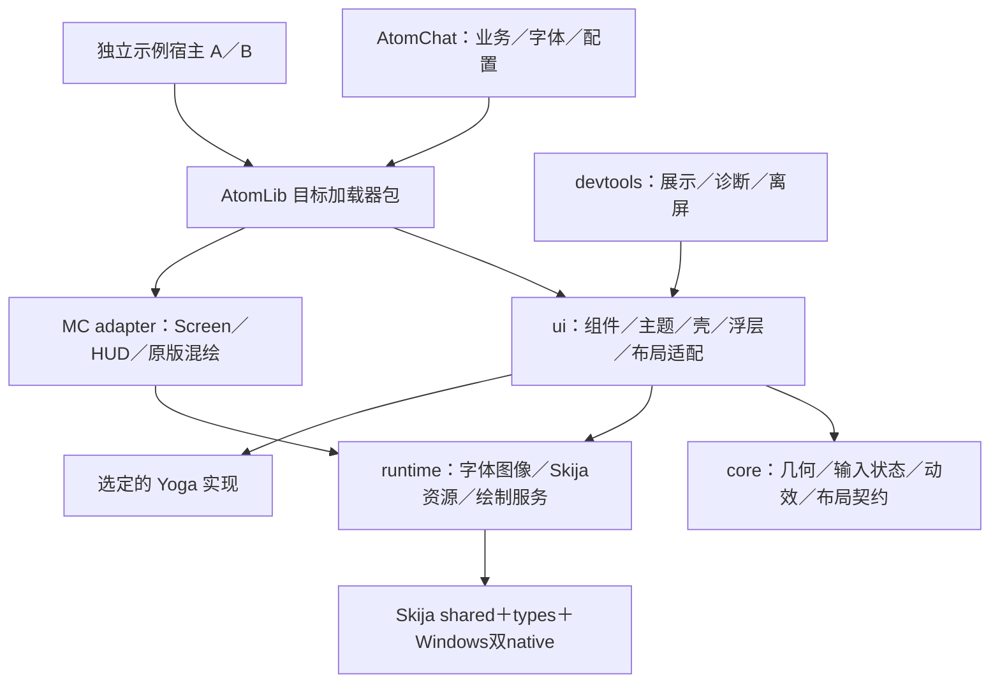

# AtomLib 提取与 Yoga 接入实施方案

> 状态：历史完整方案。编写者：Astra；日期：2026-10-29；2026-11-01 补记当前范围。
> 原编写轮仅写入本文，下面保留当时的任务与接口设计，不代表当前 API 或已完成清单。
> 实施需获得用户对本方案的确认；本文件不授权提交、推送、发版、部署、启动游戏或变更版本号，不要求任何未安装的 superpowers 工具。

> 当前实现以两仓 `docs/STATUS.md`、AtomLib `docs/api-contracts.md` 和 `docs/next-directions.md` 为准：2026-10-31 已移除通用组件、浮层、滚动、视图宿主、壳和 devtools，保留渲染桥、Yoga、文本／资源／输入原语与可选 AC 设计包；方向 F 已明确改为附带默认字体。不得据本文恢复已删除层或继续执行旧的“禁止字体”门禁。
> 对照结论：这些范围变化已有记录，但本文末尾“仅提供数据、动作和页面结构即可构建完整界面”的创作者易用性目标尚未验收。现有 settings-home 离屏复刻是静态基础栈证据，不能替代 T7 的真实控件／输入闭环，也不能填绿 T8–T11 或双消费者验收。

**目标：**建立方便创作者制作 Minecraft UI 的 AtomLib：开放 Skija 原始绑定，提供可靠的渲染接入、布局、文本、输入、主题、组件、交互、可选壳和开发工具，使常规页面主要描述结构、数据与动作。

**架构：**Skija 负责绘制，Yoga 负责盒模型布局；现有框架中的主题、组件、动效和交互经来源核查与解耦后复用。绘制、命中、裁剪、滚动消费同一份布局快照。先交付最小库并接入 AC 的真实设置区，再扩展公共能力。

**技术基线：**Java 17 兼容的公共代码、Skija 0.143.18、HumbleUI types 0.2.0；三个 Minecraft／加载器工程独立构建。Yoga 实现由任务 T1 的证据门确定。

## 1. 已确定的边界

- 名称 AtomLib，建议 mod id `atomlib`、Java 包 `com.atom.lib`；包名不是已登记的 Maven group。
- AtomLib 新写自有代码使用 Apache-2.0。确可提取的 AC／Trellis MIT 内容保留原版权与许可；第三方代码、native、素材分别保留声明。
- Tuui 为 ARR，仅学习职责划分、标准 API 使用与通用算法思路；禁止复制其反编译代码或资源。AC 中已存在的来源疑点必须单独核查。
- Lib 不附带字体文件，包括默认字体、Emoji 字体和测试字体进入发行包的情况。宿主注册字体；库负责加载、回退、缓存、测量和释放。
- 首版发行 native 只包含 Windows x64 与 Windows ARM64，二者放进同一个加载器目标包；根据 JVM 架构选取，不能根据物理 CPU 推断。
- 保持 Forge 1.20.1／JDK17／Gradle8.8，Fabric 1.21.1／JDK21／Gradle8.8，NeoForge 1.21.1／JDK21／Gradle9.2.1。Fabric Loom 当前为 1.7.4。
- 不升级 Minecraft 自带 LWJGL；1.20.1 的候选绑定为 3.3.1，1.21.1 为 3.3.3。后者由本机会话中的官方 minecraft-info.json 核对记录支持，实施时归档实际依赖图。
- AC 聊天记录、网络、草稿、玩家资料、配置持久化和原有字体留 AC；AtomSound 的音乐架构不在本方案修改范围。
- 普通页面通过语义组件和主题 token 组合；自定义绘制有明确入口。不开发完整 CSS 语言、浏览器、跨渲染引擎框架或操作系统式桌面。
- 首版不扩张到 Lottie、节点编辑器、无限画布、复杂图表和新的特效库。保留 Skija 原始入口，已有 SkSL 效果先留 AC，按真实需要再抽。

## 2. 基线与证据范围

本轮核实 AC 为 `main@28fd6de0caf1133ffba97c63315d55bdf21aef48`，写本文前工作区干净。`docs/STATUS.md` 记录 0.4.0 续开发已验收；该验收不自动覆盖拆库后的版本。本轮未运行构建、测试、native 探针或游戏。

| 证据 | 已知事实 | 不能据此宣称 |
|---|---|---|
| `versions/targets.json`、三端 `build.gradle` | 当前三目标、Java／Gradle 分离；Forge／NF jarJar、Fabric include | 新库的开发依赖与发行依赖已经打通 |
| `gradle.properties`、`gradle/atomchat-native-platform.gradle` | Skija 0.143.18，现有三 OS／架构变体 | 新库双 native 元数据一定正确 |
| 本会话既有合包探针记录 | Windows x64／WSL Linux x64 CPU 绘图曾成功 | MC 类加载、GPU、Windows ARM64 已通过 |
| 本机 `yoga-probe/result.txt` 与 `YogaSkijaProbe.java` | JDK17.0.18／LWJGL3.3.1，320→640 使内容宽176→496、文字高132→44 | 中文排版、输入、三端加载、JNI 生命周期和实机性能已通过 |
| Windows ARM64 Yoga 产物检查记录 | 3.3.1 对应 JAR 存在，PE machine 为 0xAA64 | ARM64 JVM 与 GPU 实机已通过 |

Yoga 探针位于 `C:/Users/NIUQU/.codex/visualizations/2026/10/29/01a186d6-bbc8-70b0-8c54-2f104cc36947/yoga-probe/`。其换行仅按英文空格处理，测量约束覆盖有限，不能直接升级为生产文本实现。

已读参考：`D:/Trellis/docs/ai-guide.md`、共享记忆 `project_trellisui-framework.md`、`D:/AtomSound-main/docs/shell-port.md`。吸收稳定 ID、单一几何、语义 token、时钟注入和实例隔离经验；旧“各仓 vendor／不建中心库／只能直画”由本次用户目标取代。

## 3. 来源与许可：先通过，再提取

“在 AC 内且根 LICENSE 为 MIT”不等于其中所有内容均可作为 MIT 内容迁移。当前源码明确出现以下注释，属于需要核查的线索，不直接构成复制或侵权结论：

| 候选 | 本轮核实的线索 | 迁移处理 |
|---|---|---|
| `shared/.../render/SkiaFontRenderer.java:14` | 标注 ported from Tuui FontRenderer | 来源门关闭前不直接搬实现；可依据 Skija API 独立实现文本服务 |
| `shared/.../render/GlStateUtil.java:19` | 标注 Tuui GlStateUtil、Kotlin→Java | 核查历史与授权；不通过则根据 GL／Blaze3D 契约独立实现 |
| official／Fabric 两份 `render/SkiaGraphics.java:22` | 标注 Pattern ported from Tuui Graphics | 区分通用接入模式与具体表达；核查后决定保留或重写 |
| `shared/.../render/Animator.java:4` | 标注 SmoothAnimator concept | 核查是否仅为通用插值思路，记录结论及依据 |
| `shared/.../ui/AbstractCanvas.java:10` | 标注 modeled after Tuui | 首版不直接采用其组件树；仅保留可独立确认的需求 |
| `render/Easing.java`、`render/ChatBubble.java` | 另有 Tuui 比较性注释 | 一并列入来源清单，不因措辞较轻自动豁免 |

处理流程：追踪 AC 文件历史及原始提交，区分自有实现、授权移植、第三方素材与无法确认来源。每项记录来源路径／提交、作者、许可证据、使用范围、变更说明、目标文件和处理结论。结论仅允许“允许保留并附声明”“独立实现并记录依据”“取得授权后纳入”“排除”。

无法确认的候选先排除；实现者从行为契约、官方 API 与通用算法重新设计，避免拿反编译代码逐行翻译或机械改名。已阅读过相关代码的事实应记录，不宣称天然满足隔离开发。注释删除、包名更换、添加 Apache 头均不能替代来源核查。涉及历史 AC 来源问题另列审计结果，不在本次方案阶段做法律定性或改产品代码。

资产遵循同一流程：`DrawPrimitives`／`AppIcons` 含 Lucide 来源线索，不能统称原创；`tools/audio-source/README.md` 记录 DuffyBro 的 CC0 来源及加工链。通用资产按单项许可纳入；AC logo、作者标识、聊天翻译、品牌插画和字体留 AC。默认不因提取裁剪控件而引入 FlatLaf／Swing 文件选择器。

新库规划 `docs/provenance.md`（代码来源与处置）、`assets/provenance.json`（素材来源与哈希）、`LICENSE`、`NOTICE`、`licenses/`。声明进入源码包与发行包。AC 的 `THIRD_PARTY_NOTICES.md:4` 误称 AC 为 Apache，与根 MIT 不符，后续迁移任务修正文案，不改变 AC 许可证。许可依据见 [Apache-2.0 原文](https://www.apache.org/licenses/LICENSE-2.0) 与 [MIT 原文](https://opensource.org/license/mit)。

## 4. 仓库与模块设计

推荐新建独立工程 `D:/AtomLib`，本轮未创建。以下以 `LIB` 表示该规划根目录，`AC` 表示 `D:/AtomChat-Main`。方案批准时可一并确认路径；远端仓库、Maven 主机和商店项目另需授权。



| 规划目录 | 职责与依赖规则 |
|---|---|
| `LIB/core/src/main/java/com/atom/lib/` | Java17 纯模型：geometry、layout API、input、motion；不引用 MC、Skija、Yoga native |
| `LIB/runtime/src/main/java/com/atom/lib/` | Skija 资源、font、text、image、render；依赖 core，无 MC 类；原始 Skija 类型可公开 |
| `LIB/ui/src/main/java/com/atom/lib/` | layout/internal、style、component、overlay、scroll、interaction、shell；依赖 core/runtime 和唯一选定 Yoga 实现 |
| `LIB/platforms/1.20.1-forge/` | Java17、Gradle8.8、Forge47.4.10；入口、GL／MC 适配与最终 mod |
| `LIB/platforms/1.21.1-fabric/` | Java21、Gradle8.8、Loom1.7.4、Fabric0.16.9；保留 Yarn 适配 |
| `LIB/platforms/1.21.1-neoforge/` | Java21、Gradle9.2.1、MDG2.0.141、NF21.1.235；官方映射适配 |
| `LIB/devtools/` | 组件展示、布局诊断与 CPU 截图；独立开发产物，默认不进入玩家包 |
| `LIB/examples/consumer-a/`、`consumer-b/` | 独立 Gradle 消费者，仅从本地 Maven 仓库取库，验证无源码工程依赖 |
| `LIB/versions/`、`gradle/`、`tools/` | 版本锁、目标矩阵、打包与依赖校验，不能读 AC 根属性作为永久真源 |

公共模块使用根 Gradle8.8／JDK17 构建。三平台工程保留各自 wrapper；各自 settings 显式映射 core/runtime/ui 的 projectDir，公共模块 build 输出放 `LIB/build/targets/<目标>/<模块>/`，根测试用 `LIB/build/standalone/`，避免不同 Gradle/JDK 并行写同一输出。公共脚本只用两代 Gradle 均支持的 API。

面向玩家，每个目标只交付一个 AtomLib mod JAR；内部模块不是多个前置 mod。构建时合入自有模块 classes/resources，外部依赖按加载器机制嵌入并登记。模块不得再次作为同名运行时依赖进入成品。T2 必须实际证明无重复类、资源或模块名冲突。

阶段变化：T0–T2 只有来源清单、选型与可消费骨架；T3–T6 形成渲染／文本／布局／最小交互；T7 接 AC 一组真实设置并同步转移运行时打包所有权、切换AC产物校验与CI取件；T8–T11 扩展组件和壳；T12 迁移收口与全矩阵发行验证。无需等所有组件齐全才让消费者参与。

## 5. 能力与源码提取矩阵

下表中的 `shared/...` 均指 `AC/shared/src/main/java/com/atom/chat/`；`official/...` 指 `AC/layers/mapping/official/src/main/java/com/atom/chat/`。官方映射相关代码必须同时核对 Fabric 平行副本，按 `versions/layers.json` 维护接缝。

| 源码／能力 | 技术分类 | 目标与边界 |
|---|---|---|
| `ui/SpringAnim`、`UiMotion`、`avatar/CropMath` | 来源通过后可迁核心 | `core/motion`、`core/geometry`；时钟作为输入，保留数学测试 |
| `nav/NavigationStack`、`ui/ConfirmationState`、`ui/input/InputRouter` | 小模型可迁 | `core/input`／`ui/shell`；Router 不冒充完整 capture／focus 系统 |
| `notification/NotificationHudLayout`、`NotificationHudEditorModel` | 少量解耦 | `ui/interaction/HudPlacementModel`；移除 AC 翻译 key，保留九宫格、偏移、0.5～2等比缩放 |
| `notification/NotificationHudEditor` | 明确解耦 | 宿主提供预览绘制、初始值与保存回调；不依赖 NotificationBanner 或通知队列 |
| `official/render/SkiaGraphics`、`shared/render/GlStateUtil` | 来源门＋生命周期重构 | MC renderer 与 GL scope；去掉 AC 日志、FrameProfile、debug 配置，不能直接照搬静态保存槽 |
| `render/SkiaDraw`、`DrawPrimitives`、模糊相关实现 | 来源逐项核查＋解耦 | 通用绘制配方与背景模糊；去掉AC开关、主题与诊断依赖，保留失败实底回退 |
| `shared/render/SkiaFontRenderer`、`font/FontManager` | 来源门＋独立文本服务 | 宿主字体，完整测量键、回退和释放；当前 WIDTH_CACHE 按字号分桶不足以区分字体 |
| `ui/UiTokens`、`theme/ThemeService` | 参数化 | `ui/style` 的不可变主题快照；不读取 AtomChatConfig |
| `settings/SettingsSlider`、`official/settings/SettingsSectionPage:2759/3078` | 拆成独立控件 | 连续 preview、release commit、cancel；重排后轨道更新，保存回调留 AC |
| `ToggleSwitch`、`ConfirmationDialog`、`MenuPopup`、取色器 | 解耦 | 统一主题／时钟／模态协议；危险语义仅用于真正危险操作 |
| `official/avatar/ImageCropper` | 解耦与资源审计 | 图片平移、滚轮缩放、固定比例裁剪、PNG结果回调；存储、上传和文件选择留宿主 |
| `ui/ScrollController` | 解耦 | 参数与时钟注入，滚动上下界由统一快照提供 |
| `ui/UiLayout`、`ShellHeader`、`BottomTabBar` | 重新定义通用槽位 | header/body/footer、可选导航；按钮动效实例化，移除固定3个Tab及聊天输入槽假设 |
| `nav/PageTransitionDirector` | 核心可拆 | 保留可中断动效、完成后 pop；草稿、引用、固定页面类型留 AC |
| `nav/NavStackController`、`PageTransitionComposite`、`HeaderChrome`、`ScrollSyncService` | 留 AC | 协调聊天页面、玩家状态、草稿与具体合成，不因位于 shared 就泛化 |
| `ui/UiComponent`、`AbstractCanvas` | 不直接发布为成熟体系 | 现有生产接线有限，子 drag/release 转发不完整；新体系从最小契约建立 |
| `ComposerInput`、聊天列表、网络、配置、个人素材 | 留 AC | 通过宿主接口使用库；不把聊天文本限制、搜索、草稿借用变成公共默认规则 |

## 6. Yoga 选型与证据门

推荐先以 **Applied Energistics 纯 Java 移植为首选候选** 做限域比较：可减少一组 JNI、两种 LWJGL 版本和 native 分发差异；已有跑通的 LWJGL 路线作为可行备选。纯 Java 尚未在本项目运行，不能直接宣布定案。

| 方案 | 已知依据 | 必须验证 |
|---|---|---|
| AE Java port | 上游声明纯 Java、MIT，公开 Maven 坐标 `org.appliedenergistics.yoga:yoga`，README 对齐上游提交 `6455a848a76f433bdb48b2640b7f4644774c76fd` | 实际发布版本／哈希、Java17 字节码、API与线程语义、测量约束、性能、两宿主隔离；不假设等于最新版 Yoga |
| LWJGL Yoga | 3.3.1 桌面探针成功；官方提供 C API 绑定；1.21.1 需匹配3.3.3 | 两个版本能力交集、Windows双架构资源路径与加载、JNI回调释放、loader依赖冲突；不得带入替代 MC 的 lwjgl-core/glfw/opengl |

来源：[AE README](https://github.com/AppliedEnergistics/yoga)、[3.3.1 绑定源码](https://github.com/LWJGL/lwjgl3/blob/3.3.1/modules/lwjgl/yoga/src/generated/java/org/lwjgl/util/yoga/Yoga.java)、[3.3.3 绑定源码](https://github.com/LWJGL/lwjgl3/blob/3.3.3/modules/lwjgl/yoga/src/generated/java/org/lwjgl/util/yoga/Yoga.java)。最新 LWJGL Javadoc 只能用于定位，不能作为这两个版本的方法清单。

T1 对两条路线运行同一组测试：row/column、grow/shrink/basis、min/max、padding、wrap、百分比约束、隐藏节点、文本 Exactly/AtMost/Undefined、内容变更 dirty、缩放像素取整、稳定节点增删与回收。gap 不依赖新 API：缺少时在布局适配层以子项间距实现，且首末边界无额外间距；先测再开放。

选型规则：纯 Java 在 Java17／21 与上述契约全部通过，且真实设置树及100／1000节点样本没有不可解释的增长、长暂停或持续内存增加，则采用纯 Java；记录绝对耗时、分配和对照，不用上游性能百分比替代本机证据。否则采用匹配各目标 LWJGL 的 native 路线。两者都失败则停止布局扩展，保留运行时提取成果，修正方案后再继续。

不同时发行两套后端、不提供用户运行时切换、不自研第三个 Flexbox 引擎。选择结果写 `docs/decisions/yoga.md` 和 `versions/dependencies.properties`；后续任务只依赖 AtomLib `LayoutEngine`。公开接口不暴露 Yoga 节点指针。

## 7. 接口草案与共同契约

以下为设计接口，均非当前仓库已有 API；每个公开类型独立一个 Java 文件。限定初版所需契约，具体内部实现由对应任务完成。

### 7.1 几何、布局与帧

核心值类型：Rect／Viewport放 `core/.../geometry/`，FrameTime放 `core/.../motion/`，NodeId及布局契约放 `core/.../layout/`；T2先建立这些无实现依赖的契约，T5接入真正的布局引擎：

```java
public record NodeId(String value) {}
public record Rect(float x, float y, float width, float height) {}
public record Viewport(float width, float height, float pixelsPerUnit) {}
public record FrameTime(long frameId, long nowNanos, double deltaSeconds) {}
public record LayoutBox(Rect border, Rect content, Rect hit, Rect clip,
                        NodeId parent, NodeId scrollOwner) {}
public interface LayoutSnapshot {
    long revision();
    LayoutBox box(NodeId id);
    java.util.List<NodeId> paintOrder();
}
public interface LayoutEngine extends AutoCloseable {
    LayoutSnapshot layout(LayoutTree tree, Viewport viewport);
    void close();
}
```

`LayoutTree` 是 core 中受控树接口，提供 `root()`、按 NodeId 查询 `LayoutNode`；节点提供 ID、children、LayoutStyle 和可选 LeafMeasure。LayoutStyle 只含上述已验证布局子集，不含颜色或资源。`LeafMeasure.measure(Constraints)` 返回 `MeasuredSize(width,height,baseline)`；Constraints 每轴由值和 EXACTLY／AT_MOST／UNDEFINED 枚举组成。根的 parent、无滚动宿主的 scrollOwner 可为空，其他查询不存在必须抛出含 NodeId 的错误，不返回零框掩盖接线遗漏。

`LayoutSnapshot` 为只读逻辑坐标结果。`ui/layout/PresentationFrame` 从它及滚动／页面变换生成可见矩形、累计 clip 和逆变换；绘制与输入共同使用这份展示帧。按压弹簧只作用于视觉，hit 保持稳定；整页移动和滚动则更新展示帧的绘制与命中变换。不得让旧 UiLayout 再覆盖 Yoga 管理的子树。

一帧顺序：取宿主数据／主题／时钟 → 应用队列事件 → 更新实例动效 → 对 dirty 布局求解 → 生成展示帧 → 绘制。输入到来时先确保展示帧与当前 viewport 同代；触发尺寸修改后标记 dirty，下一次输入／绘制前刷新。只变色不重排。新增节点按稳定 ID 调和，不每帧全量重建 native 树。

### 7.2 字体、文本、资源与绘制

`runtime/font/FontRegistry` 提供 `register(FontId, FontSource)`、`setFallbacks(List<FontId>)`、`close()`；FontId 为宿主命名空间与名称，FontSource 打开宿主提供的字节流。字体解码成功后库持有 Typeface，返回对象不得被宿主擅自 close。缺默认字体时抛出明确配置错误；缺字时按注册链回退，最终使用注册的替代字形并记录诊断，不偷偷打入字体。

`runtime/text/TextService.layout(TextRequest, Constraints)` 返回不可变 `TextLayout`：尺寸、baseline、行、字形簇边界、命中与选区几何。TextRequest 定义文字、FontId、字号、字重、语言／方向和换行／省略策略。绘制必须消费同一个 TextLayout；不再用另一套 measureText 算行。缓存键含字体身份及资源代次、字形参数、文本、宽度约束和排版策略，受容量限制。

测量实现遵循三种约束，最终尺寸读取布局结果；文字、字体与语言变化通知 Yoga dirty。[Yoga 测量契约](https://www.yogalayout.dev/docs/advanced/external-layout-systems) 用于原理，具体函数按 T1 锁定版本实现。中文、长无空格文本、Emoji／组合字符不能只按 UTF-16 char 截断。完整复杂脚本支持范围以样例结果声明，不提前声称全语言支持。

`runtime/resource/ResourceScope` 按宿主命名空间持有字体、图片、SVG和滤镜；资源重载递增 generation，旧异步结果若代次不符直接释放。CPU解码可后台执行，GPU创建／释放只在渲染线程；取消与关闭后不得回写已销毁控件。

`runtime/render/CustomPainter.paint(Canvas, Rect, FrameTime)` 为原始 Skija 绘制入口，Canvas 为本次调用借用，禁止保留或关闭。`platform/.../render/MinecraftRenderBridge` 管理上下文、FBO重建和渲染线程；原版混绘通过同桥的明确 pass 边界执行，先 flush Skija、恢复 MC 状态，再画原版内容，回来重置 Skija 状态。

首版 GL scope 采用成对实例保存／恢复；支持顺序多宿主，拒绝在活动 Skija pass 中递归开启另一 pass并报错。原版物品／tooltip通过排定的 pass 实现，不能以允许任意嵌套掩盖上下文问题。异常路径仍恢复 GL 与 Blaze3D 缓存、Canvas save 栈。

### 7.3 输入、组件与状态

`core/input/InputDispatcher` 接收展示帧的命中适配器、`PointerEvent`、`KeyEvent`、文本输入事件；返回 CONSUMED／PASS。pointer press 一旦捕获，以 NodeId 记录所有者，drag/release 不重新猜接收者；支持 CANCEL（关闭、失焦、移除、禁用、模态切换、viewport失效）。释放只触发一次提交。未消费才交给原版。

`ui/input/FocusManager` 每个视图独立，负责 Tab、Shift+Tab、失焦、焦点可见和模态 focus trap；弹窗关闭只恢复仍存在且可用的原焦点。`OverlayHost` 同时管理绘制顺序和输入栈，防止不可见模态吞输入。AC 原有动画门键盘／指针不对称规则通过适配器暂时保持，不直接变更聊天行为。

```java
public interface ValueBinding<T> {
    T read();
    void preview(T value);
    void commit(T value);
    void cancel(T valueBeforeGesture);
}
public record SliderSpec(float min, float max, float step) {}
```

滑条开始时保存值，移动实时 preview，正常松手 commit 一次；取消恢复起始值并调用 cancel。ValueBinding 由宿主决定内存与落盘，库不打开配置文件。SliderSpec 拒绝非有限数、max≤min及step≤0；拖动可连续，键盘按step移动，提交量化策略由控件的具名选项确定并与AC旧行为对照。

`ui/style/ThemeSnapshot` 包含语义颜色、TypeScale、SpacingScale、RadiusScale、MotionPolicy、材质族群。普通组件仅接受语义变体，具体几何由组件规格产生。首批 `Button`、`Label`、`SettingRow`、`Slider`、`Toggle`、`Section`、`ScrollView`；页面不可直接填写控件内部坐标。ThemeSnapshot 不持有配置单例，更新后触发布局或仅重绘由受影响属性决定。

`ui/view/UiView` 是视图生命周期所有者：持有树、布局引擎、组件状态、输入／焦点、滚动、浮层和动效；通过 HostContext 获得 ResourceScope、文本、诊断、翻译、剪贴板和反馈声音接口。HostContext 不暴露聊天或音乐服务。业务状态仍由宿主持有，UI只按稳定ID引用。

### 7.4 所有权与双宿主规则

| 对象 | 所有者 | 销毁／重载规则 |
|---|---|---|
| native／Skija Java版本 | AtomLib客户端运行时 | 只初始化一次；不依赖某个页面开关，不承诺 JVM 内卸载 DLL |
| GPU context／FBO wrapper | MC渲染桥 | FBO身份、尺寸变化时替换；客户端关闭时按渲染线程释放 |
| 字体／图片／缓存 | 各宿主 ResourceScope | 同名资源以命名空间隔离；重载失效，引用结束再释放 |
| Yoga节点／测量回调 | 各 UiView 的布局引擎 | 子树移除即释放；native回调持强引用至解绑后；close幂等 |
| 按压／转场／滚动／capture／focus | 各 UiView／组件实例 | 每frameId只推进一次，关闭清空；禁止ShellHeader式全局spring |
| 草稿／设置／保存／上传 | 宿主 | UI回调请求业务动作，关闭库视图不关闭宿主服务 |

## 8. 构建、消费与发行契约

开发者只添加目标 AtomLib 依赖就应能 import Canvas／Font／Rect；公开这些类型的模块使用 Gradle `api`，发布元数据包含 Skija shared/types 的编译传递依赖。[Gradle Java Library 规则](https://docs.gradle.org/current/userguide/java_library_plugin.html#sec:java_library_separation) 是设计依据，最终用 Gradle8.8／9.2.1验证。

本地先发布到 `LIB/build/test-maven`，不用外部主机或全局 mavenLocal 作为唯一证据。示例从该目录和标准上游仓库解析，禁止 includeBuild／文件源码依赖。用测试专用版本区分候选，不修改 AC `mod_version`；AtomLib 正式版本号在发行前单独确定。

Loom 会处理依赖中的嵌套 JAR，不能靠发行包里的嵌套内容保证开发编译可见。[Loom文档](https://docs.fabricmc.net/develop/loom/) 当前版本比本项目新，T2必须以1.7.4实际解析结果定案。开发期可解析传递Java依赖；生产宿主不得再include/jarJar AtomLib、Skija或Yoga。

Forge/NF的嵌套版本协商与Fabric的元数据分别验证；参照 [Forge JarJar](https://docs.minecraftforge.net/en/fg-6.x/dependencies/jarinjar/) 和 [NeoForge1.21.1 modfiles](https://docs.neoforged.net/docs/1.21.1/gettingstarted/modfiles/)。公开Skija类型不做 relocation；遇到其他mod带不兼容Skija版本要识别并说明冲突，不承诺能任意并存。测试兼容重复依赖去重和不兼容版本的可诊断失败。

发行包：一份shared、一份types、x64及ARM64各一份Skija native；版本／资源目录／PE架构一致并登记。若采用native Yoga，额外只带匹配目标的yoga绑定及两份native，核实classifier、资源重名和模块登记；不得嵌MC自带LWJGL核心。pure Java路线只带选定Java实现。

服务器边界：客户端才初始化UI类与native；服务端入口不能在字段、方法签名、类字面量或静态初始化中触发客户端类型。Forge/NF按目标版本的客户端依赖声明验证。Fabric无条件depends可能与“服务器无需Lib”冲突，优先采用客户端依赖检查及受控缺库提示，或在T2证明可行的客户端模块拆分；不得编造按侧depends字段。选择须以真实缺库客户端／专服启动证据确定。

推荐结果为“AC专服无需AtomLib；误装AtomLib在专服不加载native且不破坏AC服务”。[Forge侧隔离说明](https://docs.minecraftforge.net/en/1.20.1/concepts/sides/) 只是原则，启动测试必须覆盖三端。此处的启动验收安排在后续单独授权环境，本文不执行。

## 9. 分阶段任务

每项按“行为契约或失败样例 → 最小实现 → 单元与产物验证 → 接线 → 审阅”执行；不为文档和小型重命名机械增加测试。以下文件均为明确目标，未存在的路径标为新增。`...` 在来源矩阵表示上文定义的包根，任务清单使用确定的路径缩写：`C/R/U/D`分别为LIB的core/runtime/ui/devtools下`src/main/java/com/atom/lib`，其测试对应`src/test/java/com/atom/lib`。

### T0：来源门与迁移基线（后续所有复制依赖本项）

文件：新增 `LIB/docs/provenance.md`、`LIB/assets/provenance.json`、`LIB/LICENSE`、`LIB/NOTICE`、`LIB/licenses/`；新增 `AC/docs/verification/atomlib-baseline.md`，保留当前基线测试与图像记录。

- [ ] 将第3节全部候选和每个待搬素材登记，逐项给出处置；没有证据的候选明确排除，不能填“默认MIT”。
- [ ] 为独立实现写标准API／行为依据、作者与差异说明；保留原有来源事实，必要授权缺失时只阻塞相关迁移。
- [ ] 在后续实施环境记录git基线、三个既有test build结果、GoldenFrame捕获与显式跳过项；截图不替代真实交互记录。
- [ ] 生成允许迁移清单；后续任务只能消费清单允许项，其他能力按行为契约独立实现。

验收：每一拟迁源码／资源均有结论；已知Tuui线索无漏项；AC/Lib许可证不同且声明明确。此门通过不表示整个AC历史来源已经得到法律定性。

### T1：Yoga 两路线契约比较与锁定

文件：新增 `LIB/probes/yoga/build.gradle`、`src/test/java/com/atom/lib/probe/LayoutContractTest.java`、`TextMeasureContractTest.java`、`LayoutLifecycleTest.java`、`LIB/docs/decisions/yoga.md`、`LIB/versions/dependencies.properties`。探针构建用独立测试source sets，每次进程只加载一个实现。

- [ ] 从官方发布元数据选择AE实际版本，核对字节码、许可和源码提交；将依赖版本、SHA-256、上游Yoga提交写入锁表，不使用动态latest。
- [ ] 为两路线实现探针适配器，运行第6节同一契约；native分别在LWJGL3.3.1与3.3.3独立进程执行，避免同进程混版本。
- [ ] 加入中文长文本、英文长单词、字号／字体变化dirty、零宽、无限约束和两棵树交替布局；断言尺寸有限、上下界正确、关闭后活跃节点归零。
- [ ] 对真实设置树与100／1000节点树记录稳定与dirty布局耗时、分配、重复创建销毁；按第6节规则选择唯一实现。

验证命令（在该任务创建wrapper与source sets后）：`LIB/probes/yoga/gradlew.bat test --no-daemon --console=plain`，分别在JDK17和21执行；由构建内独立Test任务聚合三候选运行结果。验收文档列出实际通过／失败、版本差异及为何选择，不用“有Java绑定”代替结论。

### T2：最小可消费库、三目标骨架及依赖门

文件：新增 `LIB/settings.gradle`、`build.gradle`、`gradle.properties`、`gradle/module-layout.gradle`、`gradle/atomlib-dependencies.gradle`、`versions/targets.json`、core/runtime/ui的`build.gradle`；三`platforms/<目标>/settings.gradle`、`build.gradle`、wrapper和元数据；新增 `LIB/tools/verify_artifacts.py`、`test_verify_artifacts.py`；两个examples的三目标工程。建立第7.1节基础类型：`C/geometry/{Rect,Viewport}.java`、`C/motion/FrameTime.java`、`C/layout/{NodeId,LayoutBox,LayoutSnapshot,LayoutTree,LayoutNode,LayoutStyle,Constraints,LeafMeasure,MeasuredSize,LayoutEngine}.java`，作为T3/T4/T5共同依赖；新增 `R/RuntimeHandle.java`、`R/AtomLibRuntime.java`。

- [ ] 建立第4节模块与输出隔离，公共字节码Java17；最小API为 `RuntimeHandle extends AutoCloseable`，提供 `boolean isClosed()` 与幂等 `void close()`，由 `AtomLibRuntime.open()` 返回。仅客户端入口或CPU测试显式调用open，common入口不得调用；关闭句柄不尝试卸载native。T3在此基础上实现绘制与资源scope，不提前要求FBO能力。
- [ ] 配置本地测试Maven仓库、sources/Javadoc产物和明确compile/runtime依赖；T1决定的版本从锁表读取。
- [ ] 示例A仅声明AtomLib，编译并调用Skija Canvas、Font与types Rect；示例B同进程共用库。禁止示例靠AC源码或开发机隐藏文件解析依赖。
- [ ] 检查三端compileClasspath/runtimeClasspath及POM/Gradle metadata；宿主成品无Skija/Yoga/native，库成品嵌入及登记完整。
- [ ] 先解决Fabric缺库客户端与AC专服依赖策略，记录对应实现方案；此项未证明前禁止大规模迁移AC。

验收：三个目标都可构建库与外部示例；Windows双native的Java版本、PE0x8664/0xAA64和资源目录校验通过；T1选native时对Yoga做同等检查。测试仅CPU／类路径通过时，运行表标“未验证加载器启动”。

### T3：渲染桥与资源生命周期

文件：新增 `R/render/RenderSession.java`、`CustomPainter.java`、`R/resource/ResourceScope.java`；三平台 `src/main/java/com/atom/lib/client/AtomLibClient.java`、`render/MinecraftRenderBridge.java`、`GlStateScope.java`、`VanillaPass.java`、`BackdropBlur.java`；测试 `RenderScopeTest`、`ResourceScopeTest`、各平台 `GlRoundTripTest`、`BackdropBlurFallbackTest`。

- [ ] 依据T0结论独立实现或提取渲染桥，使用诊断接口取代AC日志／FrameProfile／debug读取。
- [ ] 测试FBO同尺寸换身份、resize、关闭重开、回调抛异常、save栈泄漏及递归pass被明确拒绝；退出后GL驱动状态与Blaze3D缓存一致。
- [ ] 资源按宿主scope及generation管理；模拟关闭期间解码完成、资源重载期间图片返回，旧结果必须释放。
- [ ] 用先Skija→原版物品→Skija→原版tooltip的顺序验证颜色、剪裁、深度／混合和最终状态；不抽掉AC已验证的PACK/PBO保护。
- [ ] 模糊按T0允许来源提取或独立实现，区分最终显示帧RGB与透明离屏premultiplied alpha；失败回退实底，沿用现有Iris／Bliss黑屏回归的行为条件。

验收：CPU作用域测试＋隐藏GL测试均有实际执行计数；原版物品／tooltip、Iris／Bliss及实际Screen/HUD仍列入后续游戏验收。GL无法运行时停止宣称该层完成。

### T4：宿主字体、统一文本与图形资产

文件：新增 `R/font/FontId.java`、`FontSource.java`、`FontRegistry.java`、`R/text/TextRequest.java`、`TextLayout.java`、`TextService.java`、`R/image/ImageStore.java`、`SvgStore.java`；新增 `FontIsolationTest`、`TextMeasureTest`、`TextLayoutTest`、`ImageReloadTest`；通用资产放 `LIB/ui/src/main/resources/assets/atomlib/`。

- [ ] 以宿主提供的字体字节构造注册与回退；离屏测试由测试宿主提供有许可的测试字体，确认不进入Lib发行资源。
- [ ] 同字号不同字体／字重／宿主测量互不污染；重载字体后宽度与Yoga dirty生效；每个native对象释放可计数。
- [ ] 统一绘制、测量、行断点、命中／选区；覆盖中文无空格换行、Emoji序列、组合字符、末尾省略、空文本与约束极限。
- [ ] 实现位图contain/cover、圆角遮罩、SVG加载着色与缓存；只迁T0批准的通用图标、材质和反馈音效，保留来源。

验收：字体缓存不能再只按size；同布局文本绘制不溢出约束；资源包重载与关闭不泄漏；成品递归扫描无TTF/OTF/TTC/WOFF/WOFF2及已知字体魔数，排除改扩展名漏检。

### T5：统一布局与主题规格

文件：消费T2建立的geometry／layout／FrameTime契约；新增 `U/layout/internal/YogaLayoutEngine.java`、`U/layout/PresentationFrame.java`；`U/style/{ThemeSnapshot,TypeScale,SpacingScale,RadiusScale,MotionPolicy}.java`；测试 `LayoutSnapshotTest`、`PresentationFrameTest`、`ThemeIsolationTest`。

- [ ] 将T1选定实现封装在唯一internal适配器，常规页面仅使用Row／Column／Section等组合器；适配器处理grow/shrink/basis默认值。
- [ ] 构建稳定ID树与dirty更新，保证paint、hit、clip、scroll读取同一revision；节点复用到两个父节点时报错。
- [ ] 定义从AC已认可族群提取的语义token，记录原值与来源；字号映射到宿主字体，不附带字体文件，不引入自制CSS解释器。
- [ ] 在不同viewport、GUI scale与density下验证嵌套坐标、滚动变换、像素取整；静态颜色变化不触发布局求解。

验收：新增一行设置无需修改邻行坐标；窄宽／长文／空内容不产生NaN或负尺寸；纯布局与实际绘图尺寸一致。控件内部仍可计算手柄／图标几何，禁止的是页面重复手算共享布局。

### T6：最小组件与完整输入链

文件：新增 `C/input/{PointerEvent,KeyEvent,InputDispatcher}.java`、`C/motion/{SpringAnim,UiMotion}.java`、`U/input/FocusManager.java`、`U/component/{ValueBinding,SliderSpec,Button,Label,SettingRow,Slider,Toggle,Section}.java`、`U/scroll/ScrollView.java`、`U/overlay/OverlayHost.java`、`U/view/{UiView,HostContext}.java`；测试 `PointerCaptureTest`、`FocusTraversalTest`、`SliderGestureTest`、`OverlayInputTest`、`MotionClockTest`，迁入通过来源门的SpringAnim／UiMotion数学回归。

- [ ] 先写“press→拖出→release”“press→弹模态→cancel”“捕获节点被删除”事件测试，接入一次性提交与取消恢复。
- [ ] 实现Tab导航、焦点自动可见、滚轮剩余量向父滚动区传递；模态绘制与输入开闭必须同一状态源。
- [ ] 实现ValueBinding，测试多次preview只有一次commit，cancel零commit；禁用和零宽轨道不产生非法值。
- [ ] 时间仅从FrameTime推进，同frameId二次绘制不二次更新动效；减少动效策略、快速反向与窗口失焦明确可测。

验收：输入链行为测试通过且无隐式AC保存调用；两个UiView同ID组件互不串状态。此时具备T7所需功能，不先实现所有高级控件。

### T7：AC 真实设置区试点（首次消费者反馈门）

修改：`AC/layers/mapping/official/src/main/java/com/atom/chat/settings/SettingsSectionPage.java`、`SettingsCatalog.java`及Fabric同包副本；三端`build.gradle`、客户端入口与Screen；新增 `AC/shared/src/main/java/com/atom/chat/ui/atomlib/AtomLibSettingsBinding.java`、`AtomLibThemeAdapter.java`、`AcModalAdapter.java`，official与Fabric新增 `settings/AtomLibAppearanceSection.java`。测试：新增 `AC/shared/src/test/java/com/atom/chat/settings/PanelWidthGestureTest.java`、`AcModalAdapterTest.java`，映射层 `settings/AtomLibAppearanceSectionTest.java`及Fabric副本。

首次接线还必须同步修改：Forge `src/main/resources/META-INF/mods.toml`、Fabric `src/main/resources/fabric.mod.json`、NF `src/main/templates/META-INF/neoforge.mods.toml`；`AC/gradle/atomchat-native-platform.gradle`、`tools/verify_jars.py`、`tools/test_verify_jars.py`、`.github/workflows/build.yml`、`release.yml`的构建／校验／取件部分。保留FlatLaf及其他业务依赖原归属。T12不能作为这些变更的前置条件。

- [ ] 接入Lib依赖的同一变更中，移除AC的Skija shared/types/native内嵌规则；编译依赖经Lib传递，测试native仍可testRuntime单独提供。旧页面与新页面都使用同一个Lib运行时，旧渲染入口暂作委托adapter，不能保留第二份context/native所有权。
- [ ] 同步实现`--profile atomlib-consumer`：递归断言AC零Skija/types/Yoga/native、无嵌套Lib，并验证目标侧依赖元数据；保留legacy单native profile用于旧产物夹具。新增“AC偷带native/shared、缺Lib依赖声明、误嵌Lib、缺ARM包／错PE／未登记嵌套包”等负向测试，库侧后三项由T2校验器执行。
- [ ] CI构建／取件改为每目标一个无OS后缀的AC包，配套同目标Lib包单独校验；停止生成Linux／ARM的重复AC变体，旧三包计数与单native守卫同时切换。Lib依赖使用固定版本与哈希的测试Maven输入，不能隐式读取开发机路径或追踪浮动main；CI未获得该输入就明确失败，不静默跳过。远端渠道未获授权时以隔离测试仓库输入验证，不宣称正式CI已经可用。
- [ ] 只替换外观设置中的布局调整区：标题、长说明、面板宽度滑条、现有半屏开关／选项、滚动和一个现有确认动作。确认动作经AcModalAdapter复用已有AC确认窗：打开时取消Lib捕获并暂停底层输入，关闭时恢复仍有效的焦点，绘制与拦截由同一模态状态驱动；不提前消费T8的通用ConfirmationDialog。业务数值仍由SettingsCatalog及AC配置提供。
- [ ] 同一容器边界内Yoga拥有全部子控件几何；旧AC外壳只提供矩形槽位，不能再计算该区的滑条轨道。
- [ ] 新旧页面使用同一字体、主题及配置对照；保留开发期选择旧实现的入口，运行时二选一，不能同时绘制或订阅输入。
- [ ] 建立完整回归：按宽度滑条→多次拖动→每次面板变宽并重新layout→轨道更新→松手→仅一次保存；普通／半屏各记忆宽度。取消则恢复起始值。
- [ ] 覆盖切页、关屏、拖动出面板、弹窗打断、快速resize、GUI scale变化、长中文和键盘操作；保持AC草稿／消息／搜索业务未改。

关键回归伪码仅表达事件与断言，测试应调用生产控件与AC binding，不能自己重写滑条公式作为被测对象：

```text
before = config.activePanelWidth; saves = recordingStore.count
press(widthSlider.center); drag(right1); frame(); geometry1 = snapshot
drag(right2); frame(); geometry2 = snapshot; release(right2)
assert geometry2.sliderTrack != geometry1.sliderTrack
assert config.activePanelWidth != before
assert recordingStore.count == saves + 1
assert captureOwner == none
```

验收：三端首次接线构建、AC消费者profile／Lib双native校验、对应负向夹具与CI取件演练先通过；实际生产页面离屏A/B、事件测试及后续授权游戏验收均过，才能扩展迁移。与旧图发生视觉差异须说明来自何处并交用户看图；不以新golden覆盖差异获得假绿。发行和Linux政策仍按第11节另行确认，试点构建不是发版授权。

### T8：浮层、滚动列表与文本输入适配

文件：新增 `U/overlay/{Menu,Tooltip,ConfirmationDialog,ColorPicker}.java`、`U/scroll/VirtualList.java`、`U/component/TextField.java`、三平台 `client/VanillaTextInputAdapter.java`；测试 `ModalLifecycleTest`、`NestedScrollTest`、`VirtualListTest`、`TextEditingContractTest`。

- [ ] 统一菜单／tooltip／确认窗／取色器层级、Esc顺序、边界避让、focus trap和取消语义；取色实时预览与确认提交分离。
- [ ] 首版VirtualList支持固定／已测高度和稳定key；动态高度以测量缓存与锚点补偿处理，不能给每条历史消息常驻Yoga节点。
- [ ] 实现文本编辑模型与MC输入适配：光标、选择、剪贴板、提交取消、焦点恢复；优先借用原版编辑能力，库负责布局和外观。
- [ ] 由AC适配器继续处理搜索／签名／常用语借用真实输入框及草稿恢复，不能把ComposerInput整体搬入Lib。IME实机单列，不声称键盘单测覆盖输入法。

验收：1000行列表仅布局可见窗与缓冲区，滚动到焦点可用；嵌套滚动不双消费；组合字符编辑不破坏字形簇；隐藏模态不吞输入。若通用文本框未达到此门，可先保留AC原版适配，不宣称Lib已有完整富文本编辑器。

### T9：HUD 编辑与图片裁剪交互

文件：新增 `U/interaction/{HudPlacementModel,HudEditor,ImageCropper,CropResult}.java`，按来源门迁入 `C/geometry/CropMath.java`；测试 `HudPlacementModelTest`、`HudEditorTransactionTest`、`ImageCropperGestureTest`；修改AC的 `NotificationHudEditor`、`NotificationHudEditorScreen`、official／Fabric `avatar/ImageCropper` 与 `settings/SettingsActions`接入。

- [ ] HUD从宿主获取预览内容、初始尺寸及保存回调；保留九宫格吸附、自由偏移和等比缩放，不把它描述为已有自由宽高resize。
- [ ] 测试拖动／缩放／viewport变化／边界限制，保存前不污染宿主配置或真实通知队列，取消还原草稿。
- [ ] 裁剪器接收图片资源和裁剪比例，输出有明确所有权的PNG字节结果；AC负责落盘上传。禁止直接引入宿主文件选择器依赖。
- [ ] 从真实onPress/onDrag/onScroll/confirm驱动验证图片平移、裁剪框中心锚定缩放、裁剪覆盖及结果像素；沿用 `official/avatar/ImageCropper.java:276–285` 的 `CropMath.zoomAtCentre` 语义，滚轮事件不引入鼠标坐标。鼠标锚点缩放若以后需要，另作可选功能设计；异步解码换图与关闭不会回写旧图。

验收：数学测试与完整手势测试均过；输出尺寸／像素与裁剪矩形一致；原版资源已关闭或转移，无截图样例冒充交互回归。

### T10：参数化壳与页面转场

文件：新增 `U/shell/{AppShell,ShellHeader,TabBar,NavigationStack,PageTransition}.java`；测试 `ShellIsolationTest`、`NavigationTransitionTest`、`ShellLayoutTest`；修改AC `ShellHeader`、`BottomTabBar`调用处与 `PageTransitionDirector`，保留 `NavStackController`／`PageTransitionComposite`业务协调。

- [ ] 壳参数包括标题、左右动作、内容槽、可选底部导航、关闭／返回策略；Tab列表由宿主提供，时钟文本为可选宿主内容。
- [ ] 将静态press／spring迁为实例，注入FrameTime；壳状态与消费它的协调者保持同一生命周期。
- [ ] 转场只处理页面标识与动画完成事件；pop在完成时发生，取消／反转保持当前显示值与速度，不负责聊天草稿保存。
- [ ] 测两壳同帧、快速返回再进入、零／多Tab、空标题和浮层覆盖；原版tooltip越界行为按统一overlay策略验证。

验收：AC可选择现成壳，独立宿主可只用组件或原始Skija；三条使用路径均有最小示例，不能强迫所有UI长成聊天手机。

### T11：诊断、组件展示与独立双宿主

文件：新增 `D/gallery/ComponentGallery.java`、`D/inspect/LayoutInspector.java`、`D/preview/PreviewRunner.java`、`LIB/docs/getting-started.md`、`api-contracts.md`、`ai-guide.md`；完善两个examples；测试 `DualHostIsolationTest`、`GalleryRenderTest`、`ConsumerCompilationTest`。

- [ ] Gallery显示组件默认／hover／pressed／disabled／focus、长文、窄宽、滚动与模态；取值来自生产组件，不另画一套展示专用外观。
- [ ] Inspector可显示layout/hit/clip、scrollOwner、focus/capture、布局revision、资源generation及布局／绘制耗时。默认关闭，无聊天文本采集或外网遥测。
- [ ] 同进程运行A/B：同名NodeId但不同字体／主题，交替开关、资源重载和模态；A关闭不影响B，帧时钟不重复推进。
- [ ] 独立示例提供自选字体页面、尺寸滑条、HUD编辑；另提供原始Skija与自定义绘图区示例。参考AtomSound文档检验适配能力，但不修改其播放器或工程。
- [ ] AI指南规定普通页面只组合组件和语义token；新增变体先进入Gallery，有必要自绘时使用CustomPainter并说明原因。针对页面目录的静态守卫只作补充，至少一次注入裸坐标／裸色使其变红。

验收：从空消费工程按文档能编译，无开发机绝对字体路径和AC配置引用；诊断能解释点击偏移而不靠猜。真实AtomSound接入如要实施，须另授权该仓。

### T12：AC迁移收口、CI与发行门

修改：AC三端构建／元数据、`gradle/atomchat-native-platform.gradle`、`tools/verify_jars.py`、`tools/test_verify_jars.py`、`.github/workflows/build.yml`、`release.yml`、`README.md`及实际存在的其他语言README、`THIRD_PARTY_NOTICES.md`、`docs/STATUS.md`；新增LIB `.github/workflows/build.yml`及完善 `tools/verify_artifacts.py`。版本与正式发布说明等待用户单独决定。

- [ ] 按“运行时→试点→基础控件→交互→壳”的已验收顺序移除AC重复实现，最终AC只保留adapter和业务；每步保持构建通过。迁移期间旧页面也应共用Lib运行时，不再同时携带第二份native。
- [ ] 审核并完善T7已切换的AC消费者profile与T2的Lib双native校验；旧单native校验继续保留legacy测试，不能把`==1`改成`>=1`。最终删除过渡期重复源码，确认旧页面adapter退役不影响公共运行时所有权。
- [ ] 扩展T7已有负向夹具，补齐Java/native版本错配、夹带Linux/字体/测试类、重复类及跨目标错误，全部必须失败；不把最基本的重复打包验证推迟到此项。
- [ ] 在T7已完成单AC包／配套Lib取件的基础上扩展完整CI矩阵；Linux runner的CPU测试native仅作testRuntime，不进入发行包。Windows runner执行真实GL测试；不能让Linux默认skip取代Windows证据。
- [ ] 将构建／上传取件规则、source包、README平台表和依赖范围同步；保留现有FlatLaf重定位验证，除非用户另授权迁移选择器。
- [ ] 完成第10节矩阵，独立审查来源、生命周期、输入、打包及服务端；较大代码改动由强模型审查，具体执行协作方式由后续会话安排，本轮不委托。

验收：代码、测试、可校验产物、接入文档齐备；旧类删除与孪生清单一致；Linux政策和ARM实机状态已明确，未批准不得发布或自动部署。

## 10. 验证矩阵与命令约定

当前AC已有命令如下，后续实施时执行；本轮未运行。PowerShell中按目标设置已确认存在的JDK路径，不改系统环境。首次解析新依赖不能强加`--offline`；依赖就绪后再验证离线可重复构建。不要默认复制历史关闭证书检查参数，遇证书问题先定位。

```powershell
# AC根目录，既有工具
python tools/verify_targets.py
python tools/test_verify_jars.py
git diff --check
# Forge工程目录
$env:JAVA_HOME='C:/Program Files/Java/jdk-17.0.18'
.\gradlew.bat test build --no-daemon --console=plain
.\gradlew.bat goldenCapture --no-daemon --console=plain
.\gradlew.bat goldenDeterminism --no-daemon --console=plain
# Fabric或NeoForge各自工程目录
$env:JAVA_HOME='C:/Program Files/Java/jdk-21.0.11'
.\gradlew.bat test build --no-daemon --console=plain
# 拆分前已捕获同字体、同时间、同尺寸基准后，单独执行对比
.\gradlew.bat goldenCompare --no-daemon --console=plain
```

LIB在T2定义以下构建入口后才可使用；标准任务与拟新增聚合任务明确区分：

```powershell
# LIB根：core/runtime/ui普通JUnit；devtools对生产组件渲染
.\gradlew.bat :core:test :runtime:test :ui:test :devtools:test --no-daemon --console=plain
# LIB三平台各自工程：普通构建与依赖证据
.\gradlew.bat test build dependencies --configuration runtimeClasspath --no-daemon --console=plain
# T2新增聚合任务：只发布到LIB/build/test-maven，并验证独立消费者
.\gradlew.bat publishToTestRepository verifyConsumers --no-daemon --console=plain
# T2新增产物工具：参数为目标工程，定位唯一非sources/Javadoc/slim发行包
python tools/test_verify_artifacts.py
python tools/verify_artifacts.py platforms/1.20.1-forge
python tools/verify_artifacts.py platforms/1.21.1-fabric
python tools/verify_artifacts.py platforms/1.21.1-neoforge
```

`goldenCapture`、`goldenDeterminism`、`goldenCompare`必须分三次独立Gradle进程调用：当前`gradle/atomchat-layers.gradle:389`起以请求任务中的首个mode配置同一个test任务，合并调用不会执行全部模式。保留capture基准，compare前不重新capture覆盖它。

`verifyConsumers`必须运行两示例的对应加载器编译与打包，解析发布POM，不只是当前工程的`test`别名。示例工程使用显式本地repo属性；记录依赖树中skija/types/Yoga唯一版本、解析来源和native选择。AC新profile CLI由T7新增为`python tools/verify_jars.py --profile atomlib-consumer platforms/1.20.1-forge`，其他两端同样逐个执行，文档不得在实现前称该参数已存在。

| 层次 | 必测组合与操作 | 通过证据／限制 |
|---|---|---|
| 纯模型 | Java17/21；布局、动效、capture、HUD、crop | JUnit报告，包含失败数与skip数，不能只报构建成功 |
| CPU渲染 | Win x64；测试字体、同主题同时间多尺寸 | PNG、布局快照、命中／选区断言；golden默认跳过需显式运行 |
| 开发消费 | Forge/Fabric/NF × 外部A/B；仅声明Lib | 无源码依赖、传递API可见、无重复打包；Loom1.7.4单独核对 |
| 成品静态 | 三目标 × Win x64/ARM64资源 | PE、版本、元数据、哈希、无字体/业务/测试类；不等于运行验收 |
| x64客户端 | 三目标，实际mods目录只有AC+Lib及必要依赖 | 加载、原始Skija、设置拖动、HUD、裁剪、模态、文本、缩放、关屏重开 |
| ARM64客户端 | ARM64 JVM，三目标及配套游戏LWJGL | native、CPU、GPU、输入均实测；x64模拟运行不能当ARM验证 |
| 服务端 | 三端：AC无Lib、AC+Lib误装；无显示环境 | AC现有托管可用，未初始化Skija/Yoga/AWT客户端资源；不要求GUI |
| 兼容与恢复 | 原版物品/tooltip、Iris/Bliss、全屏、resize、资源重载 | 帧缓冲与alpha不回归，GL／Blaze3D状态恢复，记录GPU及驱动 |
| 双宿主 | A/B不同字体主题同ID、交替模态/close/reload | B不受A销毁影响、无共享spring/capture/cache污染 |
| 缺失／冲突 | 缺Lib、版本范围外、重复Lib、第三方不兼容Skija | 加载器拒绝或明确受控诊断，不留下原生崩溃作为唯一提示 |

游戏客户端／专服启动、部署和实机截图须在后续明确授权的隔离实例执行，当前禁止启动。ARM硬件不具备时如实标未验证，不能以PE检查或CPU探针填绿。性能用同机同场景的旧AC／新AC对照，记录中位与p95、分配和首帧；持续静态帧不重算布局，长列表工作量随可见范围而非总行数增长。数值预算依据实测与用户目标确定，不凭空设美术或性能合格线。

## 11. 回退、兼容与发布边界

迁移前保存基线提交、产物哈希与视觉／交互证据；产品配置格式不因拆库改变。每个任务是可审阅单元，若后续获准提交，使用英文commit message。不要通过reset --hard清除用户工作。

T7保留开发期新旧页面选择；同一时刻只能一个实现接管输入，新旧页面都共用Lib运行时。单页失败先回到旧页面，不恢复AC内嵌native。来源门要求独立重写的旧代码，不能为赶迁移直接放进Lib。出现native、GL或类加载失败则完整回退AC依赖接线与成对产物：若恢复到独立AC基线，同时移除本次新装且无其他消费者的Lib；已有其他消费者时使用隔离实例回退，不能只换AC留下两份运行时。

正式发行前去除过渡期重复实现／开发开关，冻结公开API清单及内部包边界。首个稳定API前建议0.x策略，宿主依赖限定到已验证兼容区间；具体版本值在用户批准版本后写入，不能用无限上界。公开Skija类型意味着Skija升级也属于API/ABI兼容审查，不只检查AtomLib方法签名。

**Linux政策尚需用户选择。推荐迁移版明确仅支持Windows客户端，旧Linux版本保持原产物和说明，不继续伪装为本轮兼容。**若用户要求同步延续Linux客户端，应另批准增加Linux native，或另做有期限的旧实现维护分支；不偷偷把Linux包塞进已确定的首版双Windows范围。专服无UI运行能力与Linux客户端支持分开标注。

公开发布门：来源允许清单完整；开发／发行依赖均实证；三端构建与关键交互通过；客户端／服务端隔离通过；ARM验证状态获接受；用户已看过真实页面差异；Linux政策确定；仓库／Maven／商店渠道及版本另获授权。编写／批准方案不等于执行这些外部动作。

## 12. 仍需拍板的事项与完成判据

| 事项 | 推荐 | 决定最迟时点 |
|---|---|---|
| 独立工程与边界 | `D:/AtomLib`独立工程，AC仅消费；先本地测试Maven | 实施T0/T2前，批准方案可一并确认 |
| Linux客户端连续性 | 迁移版明确Windows-only，旧Linux产物保留 | T12收口与任何发行前 |
| ARM实机可用性 | 三目标获取ARM64 JVM实测；无法取得则明确未验证，不宣称全面验收 | 发行验收前 |
| 远端／Maven／商店与正式版本 | 本地验证完成后另定；不预设已获创建和发布授权 | 外部创建或发布前 |

Yoga实现由T1证据门决定，字体、Windows双native、Apache-2.0、Tuui仅学思路均不重新询问。若来源核查只能通过取得授权解决某必需功能，单独列出具体对象与替代实现成本，再由用户决定，不把整库无限等待在一个不明依赖上。

完成判据：独立创作者仅提供字体、数据、动作和页面结构，即可构建可缩放／滚动／模态／键盘可用的界面；原始Skija入口仍可用；新增普通设置行不改邻行坐标或临时捏造美术；AC试点及逐步迁移保持业务行为；两宿主资源与状态隔离；三个目标的开发与发行产物一致、来源和运行限制清楚。

## 13. 本文自查与实施入口

- [x] 全部已拍板约束已列入第1节；未更改AC版本、代码或其他文件。
- [x] 源码提取矩阵区分纯模型、需解耦、业务保留与来源待核查，不以shared目录推断通用性。
- [x] 一份布局结果、文本一致性、capture/cancel/focus、实例动效、重载释放、混绘、长列表分别有接口契约和任务。
- [x] 最小库先接真实页面，双宿主与独立消费者均有验证门；AtomSound仅参考，不默认改仓。
- [x] 开发与发行依赖、三加载器、两native、专服、Linux变化、ARM未验证、回退和发布授权都有明确位置。
- [x] 新API／任务／文件均标为设计；既有探针与本轮源码核对未冒充游戏或构建验证。
- [x] 未引入完整CSS语言、第二套同时发行布局后端或不可用的工作流工具；未自动进入实施。

方案审阅后，实施从T0来源门与T1选型门开始；任一技术候选未通过就按本方案限定替代或记录阻塞，不绕过前置门扩张范围。
