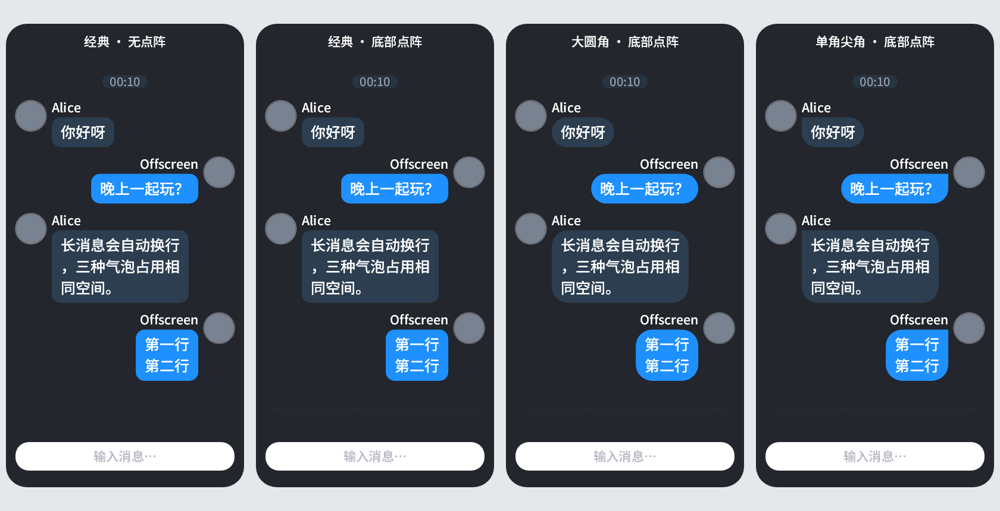

# 0.3.1 气泡样式验证

> 同日续轮已调整交互和点阵材质，开关及本记录产物已被取代；最新状态见 [点阵材质续轮验证](2026-10-20-dot-materials.md)。

2026-10-19 开工，2026-10-20（北京时间）完成本地候选。基线 main@418e22e4022eb064820e1e710ad24e81083ddd6c；源码版本 0.3.1。未提交、推送、部署、启动游戏或发布。

## 已实现

- 外观 → 主题 → 气泡样式提供经典圆角、大圆角、单角尖角；经典为默认，头像侧上角左右镜像，玩家消息本地统一选择。
- 文本、图片、下载中图片和禁用图片占位使用同一四角轮廓；系统消息、引用胶囊、反应贴纸保留自身形状。
- 点阵只作为视口底部背景，随主题次要文字色，朝上渐隐，不参与测量、命中或滚动；默认开启，可关闭，和形状一起保存到个人外观预设。旧预设缺新字段仍可读。
- 字号、昵称区高度、头像、消息间距和气泡内边距保留现值。

## 参考与实现边界

- 优先参考本机 `D:/tmp/tuui/decomp/slientrain/tuui/client/utils/extension/CanvasExtensionKt.java` 的 `RRect.makeComplexLTRB` 四角顺序，以及同形图片裁切、save/restore，使用现有 Skija 依赖独立实现。
- 图二聊天及点阵对应本机 `chatcore-1.0.0 (1).jar` / MintUI，参考 `D:/tmp/atomchat-031-chatcore-reference/org/buhuipofangle/mintui/widget/ChatBoxWidget.java`；这份代码使用 ModernUI，区别于 Tuui。网点尺寸参考原规则，透明度降为约四分之一作为小面板候选。未引入 ModernUI 或复制其源码。

## 测试

三个平台均执行 `./gradlew.bat test build --no-daemon`，退出码 0。最终 XML 统计：

| 平台 | suites | tests | failures | errors | skipped |
|---|---:|---:|---:|---:|---:|
| 1.21.1-neoforge | 167 | 1308 | 0 | 0 | 2 |
| 1.21.1-fabric | 170 | 1320 | 0 | 0 | 2 |
| 1.20.1-forge | 167 | 1308 | 0 | 0 | 2 |

- 每端各新增 14 项测试；两项跳过为原有 golden/benchmark 入口，未将跳过项算成通过。
- 首轮接口测试在缺少 BubbleStyle/绘制类时编译失败；预设的两个新增行为用例在旧实现中断言失败，随后实现通过；设置样式循环用例在未接线时失败，接线后通过。
- 真实光栅检查经典/圆润差异、尖角镜像、图片同形裁切、窄气泡和画布恢复；网点检查渐隐、颜色、透明 tint、重设视口和严格裁切。
- 实际 MessageListView 验证三种样式/点阵开关下消息命中与滚动范围一致。新增像素集成用例覆盖文字、图片就绪、下载中和禁用图片占位，左右各三款。
- 独立强模型审查未发现可确认的生产缺陷，指出只与经典截图比较不能发现 CORNER 误接 ROUND；已补直接角部像素与区域墨量检查，并复核通过。
- 变异：把 official MessageListView 的四个样式实参中的 CORNER 故意映射到 ROUND，三项实际文本/图片状态测试全部在尖角断言失败。源文件按字节备份并在 finally 恢复；最终完整三端测试在恢复后执行。日志 `.work/0.3.1-mutation.log`。
- JDT.LS open_file 后，两份新共享绘制类 diagnostics 均为空；以 Gradle 三端结果作为编译依据。

## 静态检查

- `python tools/gen_seams.py --check`：通过，甲 124 / 乙 71。
- `python tools/verify_targets.py`：通过。
- `python tools/twin_diff_report.py`：69 对，未归类差异 0，陈旧台账 0。
- `python tools/verify_log_prefixes.py`：262 个生产日志出口，违规 0。
- `python tools/bare_scan.py`：475 / 505，通过。
- `git diff --check`：通过。

## 产物

Windows 使用各平台完整 `test build --no-daemon`；Linux：NeoForge 使用 `jar`，Fabric 使用 `remapJar`，Forge 使用 `build -x test`，均带 `-Patomchat.nativePlatform=linux-x64 --no-daemon`。PowerShell 下将整个 `-P` 实参加引号。

- 六包均逐件执行 `python tools/verify_jars.py --platform <OS> <jar>` 以及 `tools/verify_chat_assets.py` 的实际校验：指定 native 唯一且已登记、版本 0.3.1、图片/声音等原资源、六份中英新增文案、新类均通过。
- 同 loader Windows/Linux 的所有顶层 `com/atom/chat/*.class`（含子目录）和 `assets/atomchat/` 文件的路径与字节聚合 SHA-256 完全一致。
- Forge Linux 首轮仅运行 jarJar，实际包尚未重混淆，OS 内容比较抓到差异；改为完整 build -x test 后包含 reobfJarJar，最终校验通过。

| 平台 | OS | 字节 | SHA-256 |
|---|---|---:|---|
| 1.21.1-neoforge | windows-x64 | 17769021 | `9f30ca0852b107c1a31ceafe46a2259554eea135de19444fa251aa75f9f50d93` |
| 1.21.1-neoforge | linux-x64 | 20129824 | `8a7624530719266de1905fcae1a1a0c785cb32231dac1956a7432326b29d60da` |
| 1.21.1-fabric | windows-x64 | 17775144 | `d228d2717f572f4f66bcb71d50319c6a965ac9a79f7b10f2001073a5eb401ca4` |
| 1.21.1-fabric | linux-x64 | 20135981 | `0b1c39061dd754831836e4043b6b7c2216f9e017eb25d554ec4b0d9a32bf0f9b` |
| 1.20.1-forge | windows-x64 | 17770012 | `d5571b7070ed3b10b9e74a8c0c10b3e868b5d61da14a810ec87bd89873a6b2fe` |
| 1.20.1-forge | linux-x64 | 20130815 | `53b6203731f110c8b61d32feb581190cdf6a90b5316ec4deee410298dc73cdc4` |

各平台完整包路径：

- [atomchat-NeoForge-1.21.1-0.3.1.jar](D:/AtomChat-Main/platforms/1.21.1-neoforge/build/libs/atomchat-NeoForge-1.21.1-0.3.1.jar)
- [atomchat-NeoForge-1.21.1-linux-x64-0.3.1.jar](D:/AtomChat-Main/platforms/1.21.1-neoforge/build/linux-x64/libs/atomchat-NeoForge-1.21.1-linux-x64-0.3.1.jar)
- [atomchat-Fabric-1.21.1-0.3.1.jar](D:/AtomChat-Main/platforms/1.21.1-fabric/build/libs/atomchat-Fabric-1.21.1-0.3.1.jar)
- [atomchat-Fabric-1.21.1-linux-x64-0.3.1.jar](D:/AtomChat-Main/platforms/1.21.1-fabric/build/linux-x64/libs/atomchat-Fabric-1.21.1-linux-x64-0.3.1.jar)
- [atomchat-Forge-1.20.1-0.3.1.jar](D:/AtomChat-Main/platforms/1.20.1-forge/build/libs/atomchat-Forge-1.20.1-0.3.1.jar)
- [atomchat-Forge-1.20.1-linux-x64-0.3.1.jar](D:/AtomChat-Main/platforms/1.20.1-forge/build/linux-x64/libs/atomchat-Forge-1.20.1-linux-x64-0.3.1.jar)

## 离屏对比与限制

每列面板 400×780，同尺寸、同消息、同配色；消息由实际生产 MessageListView 绘制，外壳、标题和输入栏为离屏比较用示意，不宣称完整游戏界面截图。头像为测试占位图。

已检查三种轮廓、左右镜像、长短/多行文字和网点位置；未做真实游戏 GPU 帧、实际背景/壁纸、多人服务器、低分辨率与极端内容缩放验收，未测新增绘制的帧耗。最终观感仍由用户在真实小面板中确认。
